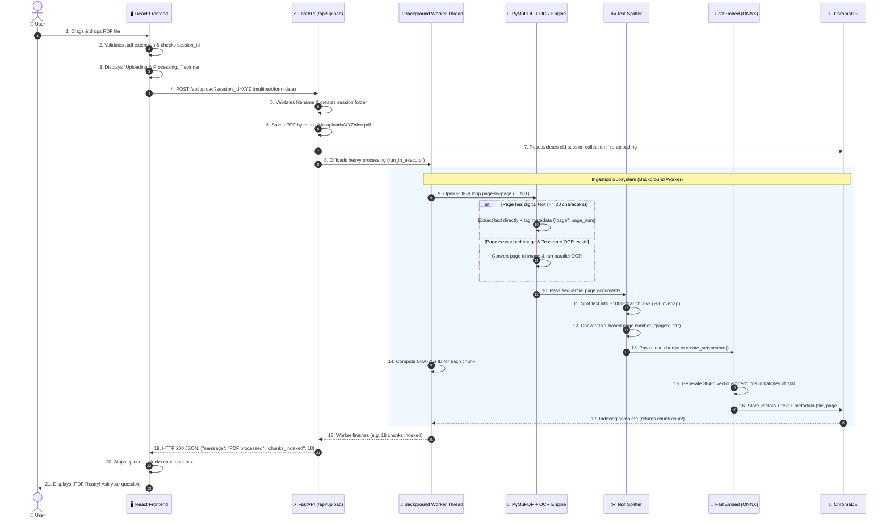
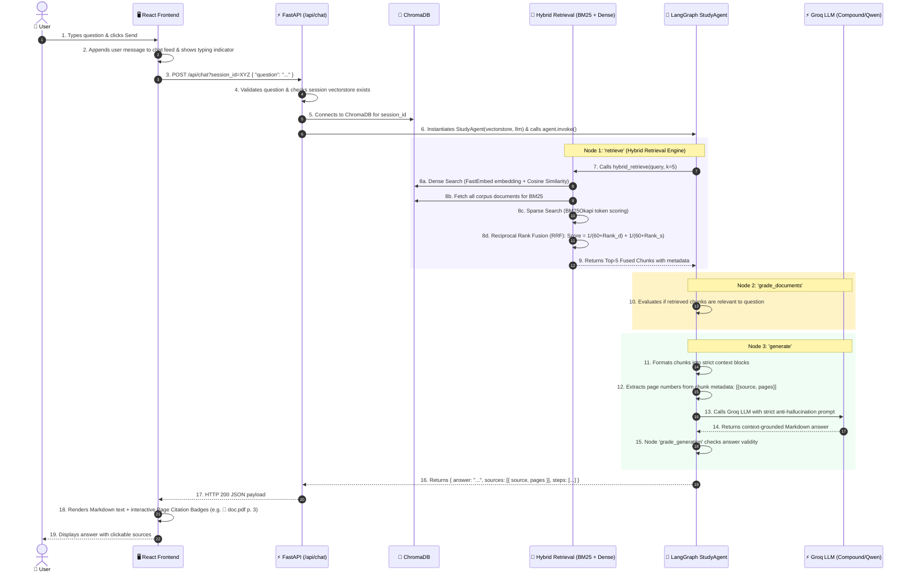
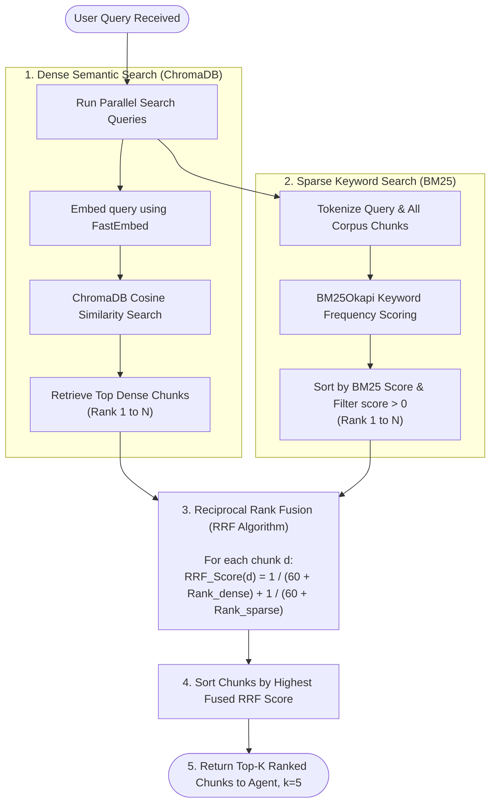
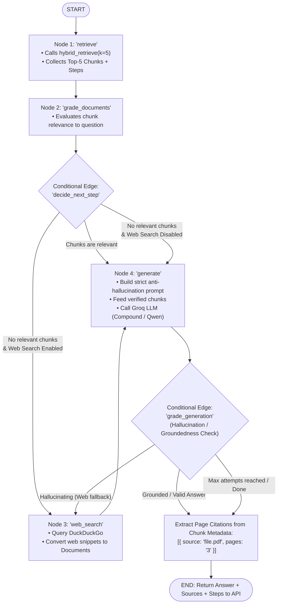
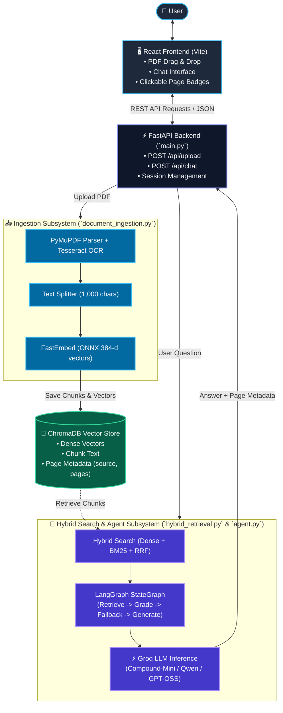

# HelpMe AI - Master Architecture & System Flowcharts

This document provides the complete, end-to-end visual flowcharts and sequence diagrams for the entire **HelpMe AI RAG & Agent** system.

---

## 1. End-to-End PDF Upload & Ingestion Workflow

This section outlines **exactly** what happens step-by-step when a user drops a PDF into the application.

### A. Sequence Diagram (Browser $\rightarrow$ Backend $\rightarrow$ ChromaDB)



### B. Upload Decision Flowchart

```mermaid
flowchart TD
    A([User selects / drops PDF]) --> B[Frontend validates .pdf extension]
    B --> C[Frontend sends POST /api/upload with session_id]
    
    C --> D[FastAPI saves file to disk at: uploads/session_id/doc.pdf]
    D --> E[FastAPI clears any existing Chroma collection for this session]
    E --> F[FastAPI spawns background worker thread]
    
    subgraph IngestionWorker ["Background Processing Thread"]
        F --> G[PyMuPDF opens PDF file]
        G --> H[Loop over Page 0 to Page N-1]
        
        H --> I{Does page have >= 20 chars of digital text?}
        I -- "Yes" --> J[Extract direct text and tag metadata: page_num]
        I -- "No" --> K{Is Tesseract OCR installed?}
        K -- "Yes" --> L[Run parallel Tesseract OCR on page image]
        K -- "No" --> M[Use available raw text characters]
        
        J --> N[Sort all pages in original sequential order]
        L --> N
        M --> N
        
        N --> O[RecursiveCharacterTextSplitter cuts text into 1,000-char chunks]
        O --> P[Filter empty chunks and convert page to 1-based string: '1', '2'...]
        P --> Q[Calculate unique SHA-256 hash ID for each chunk]
        
        Q --> R[FastEmbed converts text chunks into 384-d embeddings]
        R --> S[(ChromaDB inserts records in batches of 100)]
    end
    
    S --> T[Worker returns total chunk count to FastAPI]
    T --> U[FastAPI returns HTTP 200: { chunks_indexed: N }]
    U --> V[Frontend unlocks chat input and notifies user]
    V --> W([Ready to receive questions])
```

---

## 2. End-to-End Query & Retrieval Workflow (Asking a Question)

This section outlines **exactly** what happens step-by-step when a user asks a question in the chat interface.

### A. Sequence Diagram (Browser $\rightarrow$ Hybrid Search $\rightarrow$ Agent $\rightarrow$ Groq LLM $\rightarrow$ Answer)



### B. Retrieval & Answering Decision Flowchart

```mermaid
flowchart TD
    Q0([User types question & clicks Send]) --> Q1[React sends POST /api/chat with session_id]
    
    Q1 --> Q2{Does session vectorstore exist in ChromaDB?}
    Q2 -- "No" --> QErr[Return 400: 'No document ingested yet']
    Q2 -- "Yes" --> Q3[FastAPI initializes StudyAgent with ChromaDB & Groq LLM]
    
    Q3 --> Q4["Agent Node 1: 'retrieve' (Run Hybrid Search)"]
    
    subgraph HybridEngine ["Hybrid Retrieval Process"]
        Q4 --> H1["Dense Search:\nChromaDB Cosine Similarity (top 20)"]
        Q4 --> H2["Sparse Search:\nBM25 Keyword Frequency (top 20)"]
        H1 --> H3["Reciprocal Rank Fusion (RRF):\nRRF_Score = 1/(60+Rank_dense) + 1/(60+Rank_bm25)"]
        H2 --> H3
        H3 --> H4[Select Top-5 Highest Scoring Chunks]
    end
    
    H4 --> Q5["Agent Node 2: 'grade_documents'\nCheck chunk relevance to query"]
    
    Q5 --> Q6{"Are chunks relevant to the question?"}
    
    Q6 -- "No (Web Enabled)" --> QWeb["Node 3: 'web_search'\nQuery DuckDuckGo for web context"]
    Q6 -- "No (Web Disabled)" --> QGen
    Q6 -- "Yes (Relevant)" --> QGen["Node 4: 'generate'\nConstruct Strict Anti-Hallucination Prompt"]
    QWeb --> QGen
    
    QGen --> QLLM["Call Groq LLM (Compound-Mini / Fallbacks)"]
    QLLM --> QExtract["Extract Deterministic Page Citations from doc.metadata['pages']"]
    
    QExtract --> QCheck{"Node: 'grade_generation'\nIs answer grounded?"}
    QCheck -- "Yes / Complete" --> QReturn[Return JSON { answer, sources, steps }]
    QCheck -- "Hallucinated & Web On" --> QWeb
    
    QReturn --> QUI[Frontend displays Markdown Answer + Clickable Page Citation Badges]
    QUI --> QEnd([Done])
```

---

## 3. Dedicated Hybrid Search Engine (`backend/hybrid_retrieval.py`)



---

## 4. LangGraph Study Agent StateGraph (`backend/agent.py`)



---

## 5. Master End-to-End System Architecture



---

## 6. Technology Stack & Role Summary

| Layer / Subsystem | File Location | Technology | Primary Responsibility |
| :--- | :--- | :--- | :--- |
| **User Interface** | `frontend/` | React, Vite, CSS | Drag-and-drop PDF upload, interactive chat UI, and source citation badges. |
| **REST Server** | `backend/main.py` | FastAPI, Uvicorn, Pydantic | Non-blocking async API handling `/api/upload` and `/api/chat` with session isolation. |
| **PDF Ingestion** | `backend/document_ingestion.py` | PyMuPDF, Tesseract OCR | Page-by-page text extraction with OCR fallback and page number preservation. |
| **Chunking & Indexing** | `backend/document_ingestion.py` | LangChain Text Splitter, hashlib | Cuts text into 1,000-char chunks, assigns SHA-256 IDs, and attaches page metadata. |
| **Embedding Generation** | `backend/main.py` | FastEmbed (`BAAI/bge-small-en-v1.5`) | Generates 384-dimensional vector embeddings locally via ONNX Runtime with zero API costs. |
| **Vector Storage** | `backend/chroma_db/` | ChromaDB (SQLite + HNSW) | Persistent embedded vector database storing chunk vectors, texts, and metadata. |
| **Hybrid Search** | `backend/hybrid_retrieval.py` | ChromaDB + `rank_bm25` (BM25Okapi) | Dual retrieval (semantic + keyword) fused via Reciprocal Rank Fusion (RRF). |
| **LangGraph Agent** | `backend/agent.py` | LangGraph (`StateGraph`), DuckDuckGo | Orchestrates relevance grading, web search fallback, and groundedness verification. |
| **LLM Inference** | `backend/main.py` | Groq API (`ChatGroq`) | Ultra-fast token generation using high-speed cloud LLMs (`Compound-Mini`, `Qwen`). |
